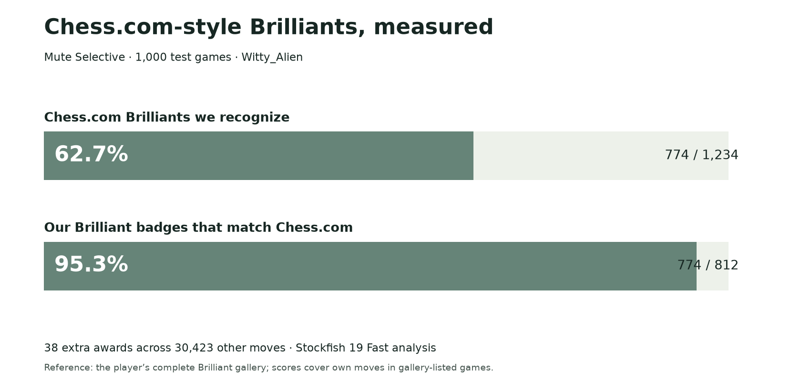

# Open Brilly Finder

Open research, code, models, and labeled chess data for **Chess.com-style Brilliant move classification**, from [Mute Chess](https://github.com/Dash1971/mute-chess).

**Recommendation: the updated Mute Selective model, with complete confirmation.** A small model trained on 6,293 labeled moves runs locally in the browser as ordinary JavaScript, alongside chess rules. It stays fixed during play; no neural network or remote AI service is needed. Mute Dev controls release—publication here does not deploy it.

## New-account test: 1,000 games

On the same 1,234 Chess.com Brilliants and 30,423 other Witty_Alien moves:

| Version | Brilliants recognized | Extra awards |
|---|---:|---:|
| Older Mute Selective | 721 / 1,234 | 57 / 30,423 |
| Older forest + complete confirmation | 725 / 1,234 | 58 / 30,423 |
| **Updated Mute Selective** | **774 / 1,234** | **38 / 30,423** |

The update finds **49 more genuine Brilliants and gives 20 fewer extra badges overall** than the older forest with complete confirmation. It recognizes **62.7%** of Chess.com’s Brilliants; **95.3% of its own badges match**. The remaining **4.7% wrong share** still exceeds our goal of fewer than 1% wrong awards. More generous settings found more Brilliants but produced too many wrong badges to choose them.



[Readable report](studies/brilliant-selective-2026-11-06/REPORT.md) · [Exact algorithm and frozen model](studies/brilliant-selective-2026-11-06/README.md) · [Methods and limitations](studies/brilliant-selective-2026-11-06/METHODS.md)

These are gallery-represented games from one held-out account, not a site-wide error estimate. Development covers 3,473 games from six other accounts, plus two separate owner examples. Model and cutoff were fixed before this account’s results. All recipes, failures, inputs, raw decisions, PGNs, labels, and evidence are retained in [the complete study archive](studies/brilliant-selective-2026-11-06/SOURCE-MANIFEST.json).

## Download the seven-account games

**7,019 games · 8,298 Brilliant annotations · 522,053 mainline plies**, with clocks and full history. Verification grades and source memberships remain explicit.

[Download PGN](studies/brilliant-selective-2026-11-06/data/seven-accounts-last-12-months-chesscom-brilliants.pgn) · [Move labels CSV](studies/brilliant-selective-2026-11-06/data/seven-account-labels.csv) · [Source counts](studies/brilliant-selective-2026-11-06/data/seven-account-source-counts.json)

## Recount or use the saved model

Python 3 standard library is sufficient:

```sh
python3 studies/brilliant-selective-2026-11-06/reproduce.py
python3 tools/infer_saved_features.py --model selective20261106 --case-key 1006812690:48
```

This recounts saved decisions and runs saved-feature inference. It is not a FEN-only classifier: fresh classification also needs legal-board and engine evidence. The native test used **SF19 smallnet 1 MB, Fast depth 12 / 500 ms, depth-14 / 500-ms confirmation, one thread, 16 MB hash**, with a six-search confirmation cap per version per game.

## Historical comparisons

Earlier explicit-label tests compared the older selective model with En Croissant: 112 of 200 Brilliants versus 53 of 200, both with three extra awards across 400 selected moves. That is a different model and sample. **En Croissant was not measured in the new Witty comparison.** [Historical report](studies/brilliant-moves/REPORT.md) · [Expanded-data studies](studies/brilliant-training-2026-11-03/README.md) · [Neural experiment](studies/brilliant-neural-2026-11-05/REPORT.md) · [Full research index](docs/RESEARCH-INDEX.md)

## Historical offline quickstart

Python 3.10+ and its standard library are sufficient:

```sh
git clone https://github.com/Dash1971/open-brilly-finder.git
cd open-brilly-finder
python3 tools/reproduce_results.py
python3 tools/reproduce_results.py --verify-forest
python3 tools/infer_saved_features.py --case-key 183200302081:135
```

The first command recomputes the external comparison from saved decisions. The second **actually runs the five archived held-out forests on all 3,724 saved feature cases**, checking every score against the recorded predictions. The third runs the original 848-case fitted forest on one saved feature example. It is inference, not a new accuracy test. [Commands, model roles and dependencies](tools/README.md) · [Recorded reproduction check](docs/REPRODUCTION-CHECK.json)

This is a research codebase, not a finished FEN-only library. Classification uses engine evidence, legal-board analysis and move history. The [portable original feature extractor](studies/brilliant-moves/reference/v5/README.md) and [native TypeScript implementation](studies/brilliant-moves/reference/v5/native/noSweatBrilliantForest.ts) are included. New engine collection requires compatible Stockfish and the documented budgets. Historical experimental scripts retain original machine paths; their presence is not a claim that every archival script runs unchanged after cloning.

## Repository map

- [`studies/brilliant-moves/`](studies/brilliant-moves/): production-model family, readable/native code, frozen model, historical independent tests and original En Croissant comparisons.
- [`studies/brilliant-training-2026-11-03/`](studies/brilliant-training-2026-11-03/): expanded corpus, PGNs, 3,724-case feature dataset, saved engine evidence, training experiments and reserved-game evaluation.
- [`studies/`](studies/): all subsequent bounded studies, their code, inputs, protocols, predictions and failed candidates, including the Ne5 queen-offer investigation.
- [`archive/research/`](archive/research/): earlier working research, including additional experiments, source snapshots and data. It preserves historical paths and superseded interpretations; use the index and current summary to distinguish final conclusions.
- [`tools/`](tools/): small portable offline reproduction and inference entry points.
- [`SOURCE-MANIFEST.json`](SOURCE-MANIFEST.json): original relative paths, byte hashes, file sizes and explicit exclusions. Scientific results are copied without rewriting their original freeze hashes.

[Data provenance and limits](docs/DATA.md) · [Research index](docs/RESEARCH-INDEX.md) · [Attribution](THIRD_PARTY.md)

## Related work and attribution

We studied and credit [En Croissant](https://github.com/franciscoBSalgueiro/en-croissant), [WintrChess](https://github.com/WintrCat/wintrchess-lib), [Knight's Eye](https://github.com/knights-eye-chess/move-classifier), [Chess-Review](https://github.com/T-Julsgaard/Chess-Review), [Brilliant-Chess](https://github.com/wdeloo/Brilliant-Chess), and [Felix's chess-game-review](https://github.com/FelixYUFENGSU/chess-game-review). Their policies and test suites provided useful comparisons, not proof that Chess.com's private algorithm has been reverse engineered. The [source review](studies/brilliant-external-repos-2026-11-04/REPORT.txt) records specific mechanisms, limitations and pinned versions.

The original work comes from [Mute Chess](https://github.com/Dash1971/mute-chess) and [Mute Chess Research](https://github.com/Dash1971/mute-chess-research). Code and research retain **AGPL-3.0-only** terms where applicable; third-party code, images and game/evidence material retain their own provenance and notices. See [LICENSE](LICENSE), [THIRD_PARTY.md](THIRD_PARTY.md) and each study's attribution. This project is independent of Chess.com, Lichess and the compared projects. Research and repository preparation used OpenAI Codex assistance.
