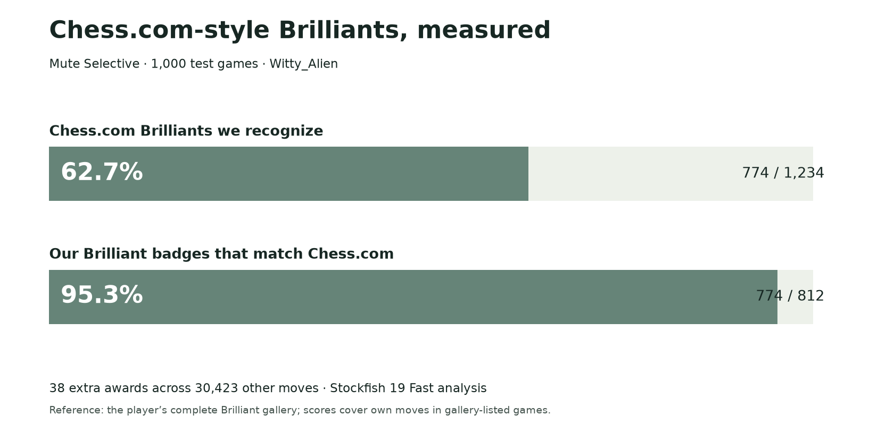

# Open Brilly Finder

**An open classifier that recognizes more than 60% of Chess.com’s Brilliant moves in our test on unseen games.**

Brilliant badges make finding a great chess idea more fun. We studied Chess.com’s labeled moves, started from En Croissant’s open-source rules, and developed **Mute Selective**: a small trained model combined with checks for move quality and a real piece offer.

## Results at a glance

In **1,000 Witty_Alien games excluded from training**, Mute Selective recognized **774 of 1,234 Chess.com Brilliants (62.7%)**. It awarded 812 Brilliant badges; **774 matched Chess.com (95.3%)**, and 38 were extra awards across 30,423 other moves.

The reference is Chess.com’s complete Brilliant gallery for that player. These results cover the player’s own moves in gallery-listed games, using Mute Chess’s default Stockfish 19 Fast analysis. They are a measured result on this sample, rather than a promise for every player or setting.

**[Read the illustrated research report →](studies/brilliant-selective-2026-11-06/REPORT.md)**

## How it works

Stockfish checks whether a move is sound. Legal chess analysis checks for a genuine piece offer. A small decision-tree forest, trained on **6,293 labeled moves**, then recognizes patterns involving material, attacks, recovery and alternatives. Two completed engine checks must support the award.

The model runs **locally in the browser as ordinary JavaScript**. Training happens ahead of time; it does not learn during play or call a remote AI service. The code and trained weights are open.

En Croissant, WintrChess and Knight’s Eye provide rule-based approaches to sacrifice classification. Mute Selective combines chess checks with patterns learned from Chess.com’s examples. [Our report explains the comparison](studies/brilliant-selective-2026-11-06/REPORT.md#how-this-compares-with-other-projects).

## Get the data and code

The annotated collection contains **7,019 games and 8,298 Brilliants across seven accounts**, including Witty_Alien and MagnusCarlsen. It preserves full games, clocks, source links and captured categories. Witty’s uncaptured categories remain marked uncategorized.

- **[Download the combined PGN](https://raw.githubusercontent.com/Dash1971/open-brilly-finder/main/studies/brilliant-selective-2026-11-06/data/seven-accounts-last-12-months-chesscom-brilliants.pgn)**
- [Move labels (CSV)](studies/brilliant-selective-2026-11-06/data/seven-account-labels.csv) and [account totals](studies/brilliant-selective-2026-11-06/data/seven-account-source-counts.json)
- [Exact algorithm, model and reproduction commands](studies/brilliant-selective-2026-11-06/README.md)
- [Methods, test boundaries and limitations](studies/brilliant-selective-2026-11-06/METHODS.md)
- [Complete research evidence](docs/RESEARCH-INDEX.md)

## What comes next

Recognize more genuine Brilliants while keeping false awards low: improve examples and position features, cover more sacrifice types, and test on more players and unseen games. More permissive methods found additional Brilliants but produced too many wrong badges to choose them.

This repository publishes the research and implementation used to inform [Mute Chess](https://github.com/Dash1971/mute-chess). App releases are managed there.

## Credits

We build on and credit [En Croissant](https://github.com/franciscoBSalgueiro/en-croissant), [WintrChess](https://github.com/WintrCat/wintrchess-lib), [Knight’s Eye](https://github.com/knights-eye-chess/move-classifier) and the other projects in our [comparison notes](studies/brilliant-selective-2026-11-06/COMPARISONS.md). This project is independent of Chess.com and those projects; Chess.com’s full classification formula is private.

[License](LICENSE) · [Third-party attribution](THIRD_PARTY.md) · [Mute Chess Research](https://github.com/Dash1971/mute-chess-research). Research and documentation used OpenAI Codex assistance.
