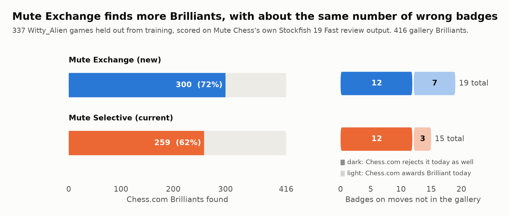

# Open Brilly Finder

**An open classifier that recognizes more than 70% of Chess.com's Brilliant moves in games it never trained on.**

Brilliant badges make finding a great chess idea more fun. We collected Chess.com's own Game Review of a thousand games, worked out what the badge requires, and built **Mute Exchange**: one simple test for a real piece offer, then a small trained model that decides which offers earn the badge.

## Results at a glance

In **337 Witty_Alien games held out from training**, Mute Exchange recognized **298 of 416 Chess.com Brilliants (71.6%)**. It awarded 316 badges; **298 matched Chess.com's gallery (94.3%)**. Our previous classifier, Mute Selective, recognized 259 (62.3%) in the same games.

Of the 18 badges outside the gallery, 7 are Brilliants when Chess.com reviews those games today.

These results use research engine settings close to Mute Chess's Fast analysis, for one titled player's games. They are a measured result on this sample, not a promise for every player or setting.

**[Read the illustrated research report →](studies/brilliant-exchange-2026-11-22/REPORT.md)**

## How it works

First, a chess test: after the move, can the opponent capture a knight, bishop, rook or queen and come out at least two points ahead on that square? That covers 8,290 of the 8,295 Brilliants we collected.

Then a model trained on **33,037 labeled moves** scores the offer. It looks at what happens if the piece is taken, whether the offer was already standing, what the opponent just did, and what Stockfish thinks of the move.

The model is a set of small decision trees. It runs **locally in the browser as ordinary JavaScript**. Training happens ahead of time; it does not learn during play or call a remote service. The code and trained weights are open.

## What we learned about Chess.com's badge

- A Brilliant is always the move Chess.com's engine liked best. Nearly best never counts.
- It always offers a piece, and almost never leaves the mover worse off.
- A piece moved into danger that cannot be won straight back is Brilliant 93% of the time. A piece merely left hanging behind a bigger threat almost never is.
- Chess.com's engine and Stockfish often prefer different moves. That, more than anything, limits how closely an open classifier can follow.

## Get the data and code

- **[Chess.com review labels for 77,696 moves](studies/brilliant-exchange-2026-11-22/data/chesscom-review-moves.csv.gz)**: class, evaluation and preferred move
- **[Annotated PGN](https://raw.githubusercontent.com/Dash1971/open-brilly-finder/main/studies/brilliant-selective-2026-11-06/data/seven-accounts-last-12-months-chesscom-brilliants.pgn)**: 7,019 games and 8,298 gallery Brilliants across seven accounts
- [Trained model, browser code and Python reference](studies/brilliant-exchange-2026-11-22/README.md)
- [Methods, test boundaries and limits](studies/brilliant-exchange-2026-11-22/METHODS.md)
- [Complete research evidence](docs/RESEARCH-INDEX.md)

## What comes next

Learn from lower-rated players, where Chess.com is more generous and we have no data yet. Find a cheap way to predict Chess.com's preferred move. Replay the test on Mute Chess's own engine.

This repository publishes the research and implementation used to inform [Mute Chess](https://github.com/Dash1971/mute-chess). App releases are managed there.

## Credits

We build on and credit [En Croissant](https://github.com/franciscoBSalgueiro/en-croissant), [WintrChess](https://github.com/WintrCat/wintrchess-lib), [Knight's Eye](https://github.com/knights-eye-chess/move-classifier) and the other projects in our [comparison notes](studies/brilliant-selective-2026-11-06/COMPARISONS.md). This project is independent of Chess.com and those projects; Chess.com's full classification formula is private.

[License](LICENSE) · [Third-party attribution](THIRD_PARTY.md) · [Mute Chess Research](https://github.com/Dash1971/mute-chess-research). Research and documentation used OpenAI Codex and Anthropic Claude assistance.
