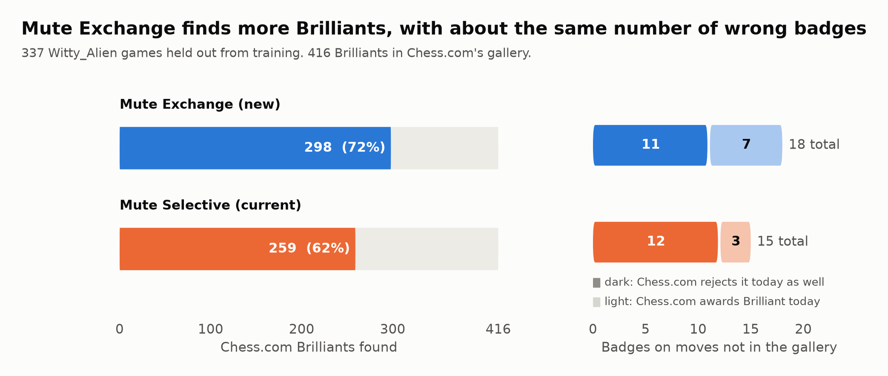
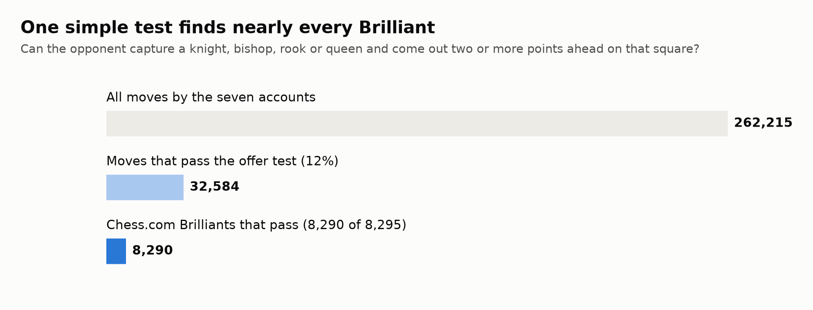
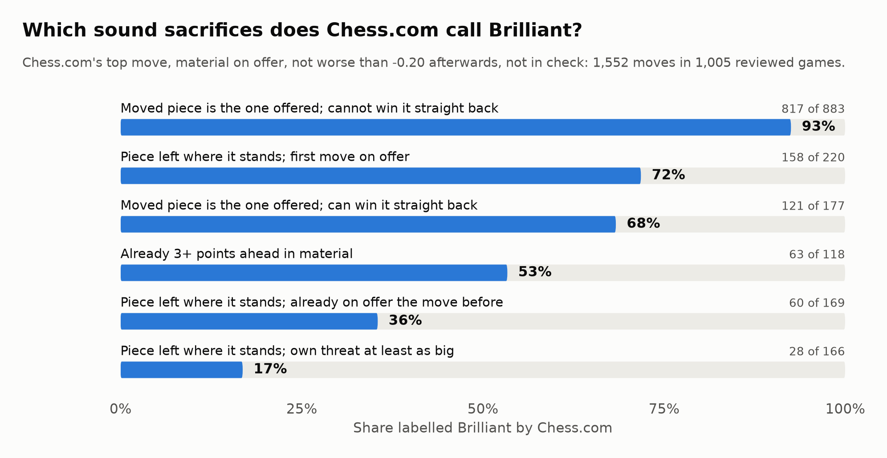
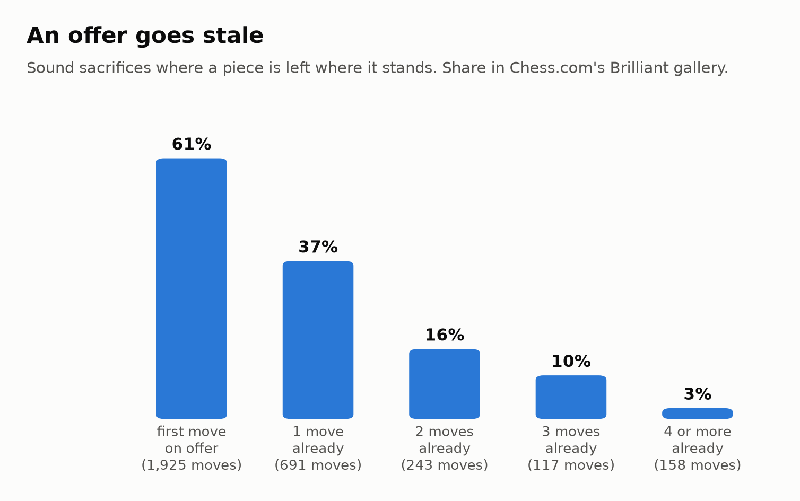
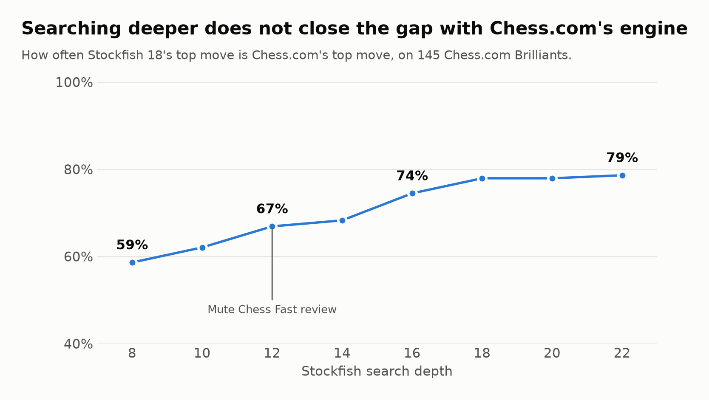
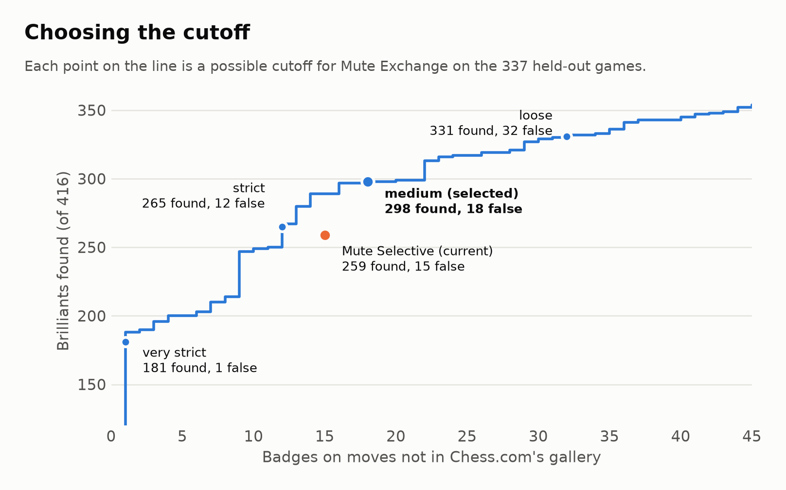
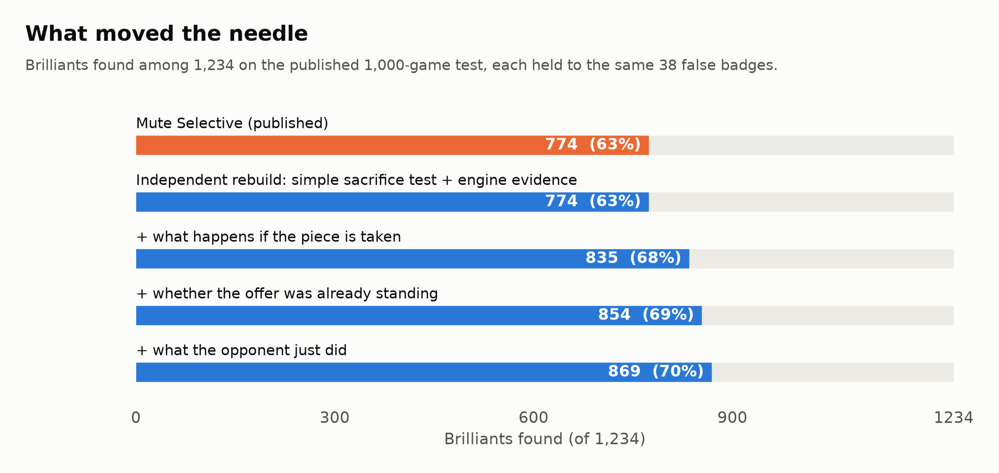
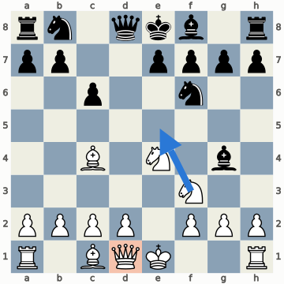
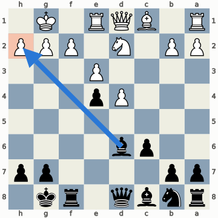

# Learning Chess.com's Brilliant badge from its own Game Review

## Abstract

**Mute Exchange recognizes 71.6% of Chess.com's Brilliant moves in games it never trained on, up from 62.3% for our previous classifier on the same games. 94.3% of the badges it awards match Chess.com's gallery.**

We got there by changing what we learn from. Earlier work started from another program's idea of a sacrifice and tuned it. This time we started from Chess.com's own Game Review: every move's label, Chess.com's evaluation and Chess.com's preferred move, for 1,005 games. That showed what the badge actually requires, and where an open classifier can and cannot follow.

## What we achieved

We tested on **337 games by Witty_Alien** that were held out from training. Chess.com's Brilliant gallery lists 416 Brilliants in them.

| | Mute Exchange | Mute Selective (previous) |
| --- | ---: | ---: |
| Chess.com Brilliants found | **298 of 416 (71.6%)** | 259 of 416 (62.3%) |
| Badges awarded | 316 | 274 |
| Badges matching the gallery | **298 (94.3%)** | 259 (94.5%) |
| Badges not in the gallery | 18 | 15 |
| ...that Chess.com also rejects when it reviews the game today | 11 | 12 |

The last row matters. The gallery is a snapshot. When Chess.com reviews these same games today it awards 28 Brilliants that are not in the gallery. Seven of Mute Exchange's 18 "wrong" badges are among them.

These numbers use research engine settings close to Mute Chess's Fast review, for one titled player. They are a measured result on this sample, not a promise for every player or setting.

## What Chess.com's review taught us

### 1. The sacrifice test is simple

After the move, can the opponent capture a knight, bishop, rook or queen and come out at least two points ahead on that square?

That one question covers **8,290 of 8,295** Brilliants across seven accounts. Where Chess.com names the piece ("Rook Sacrifice"), the named piece is the one on offer in 3,794 of 3,795 cases. About one move in eight passes, so the real work is deciding which of those are Brilliant.

### 2. The label is a rule, not an opinion

When the same position and move turn up in different games, Chess.com gives the same label 99% of the time (1,574 of 1,590 repeats). So there is something exact to learn.

### 3. It must be Chess.com's top move

We collected Chess.com's review of 1,005 games: 77,696 moves, each with its label, evaluation and preferred move. Among the gallery accounts' moves it awarded 1,194 Brilliants.

- **1,189** of them pass the offer test.
- **All 1,189** were the move Chess.com's engine liked best. Among 1,526 offers that were not its top move, **none** was Brilliant. "Nearly best" does not count.
- **1,187** gave up more material than the move itself captured.
- **None** left the mover worse than −0.17 by Chess.com's evaluation.
- **1,178** were played when the mover was not in check.

### 4. Not every sound sacrifice counts

Those conditions are necessary but not enough. About one in four moves that meet all of them is still not Brilliant. What separates them is the kind of offer:

A piece you move into danger and cannot immediately win back is Brilliant 93% of the time. A piece you simply leave hanging while making a bigger threat of your own almost never is.

### 5. An offer goes stale

If a piece was already on offer a move ago and the opponent declined, leaving it there again is much less likely to be Brilliant.

### 6. Chess.com's engine is not ours

This is the hard limit. A Brilliant must be Chess.com's top move, but Chess.com's engine and Stockfish often prefer different moves in sharp positions. Searching deeper helps up to a point and then stops.

Chess.com's evaluations also run about 1.7 times larger than Stockfish's for the same position. The two agree closely on who is better (correlation 0.97) but not on the number, and not always on the move.

With Chess.com's own numbers, 398 of the 416 gallery Brilliants in our test games meet the conditions in section 3. With Stockfish's numbers, and insisting on Stockfish's top move, only 261 do. A model that weighs the evidence instead of demanding an exact match does better, and that is what we built.

## How Mute Exchange works

1. **Offer test.** If no piece is capturable for a gain of two or more, the move is not a candidate. Nothing else runs.
2. **Board facts.** What is on offer and what the move captured. What the mover can win straight back if the piece is taken. Whether the piece was already on offer. What the opponent's last move did. How much material can be won by captures alone.
3. **Engine evidence.** The two best lines before the move and the best line after it, which Mute Chess's review already has.
4. **A trained model** turns those 91 numbers into a score. Above the cutoff, the move gets the badge.

The model is a set of 400 small decision trees. It is trained ahead of time and runs in the browser as ordinary JavaScript. It does not call a remote service or learn while you play.

It was trained on **33,037 candidate moves, 7,806 of them Brilliant**: the gallery accounts' moves, plus their opponents' moves in the re-reviewed games. Where we had Chess.com's fresh review of a game we used that label; otherwise the gallery's.

We chose the medium cutoff. A stricter one beats the previous classifier on both counts (265 found, 12 false) but leaves 33 Brilliants on the table.

### What moved the needle

On the published 1,000-game test, holding every version to the same 38 false badges:

Rebuilding the classifier from scratch with a deeper engine search and a different learner landed on exactly the previous result. The gains came from telling the model what happens when the piece is taken and whether the offer was new, not from more search or a bigger model.

## Two examples

Both are from the project owner's own games on Mute Chess. Chess.com awards Brilliant to both.

| Legal's Mate: 6.Ne5 | Greek Gift: 12...Bxh2+ |
| :---: | :---: |
|  |  |
| White leaves the queen to the bishop. If it is taken, Bxf7 is mate. | Black gives the bishop on h2 to open the king. |
| Mute Selective: `!` | Mute Selective: `!?` |
| **Mute Exchange: Brilliant** (score 0.92) | **Mute Exchange: missed** (score 0.59, cutoff 0.82) |

The Greek Gift is an honest miss. Black was already a piece ahead. Among the titled players the model learned from, Chess.com rarely awards Brilliant in that situation, yet it awarded this one to a 1500-rated player. Chess.com says it is more generous at lower ratings. Our data cannot teach that, because every account in it is rated 2400 or higher.

## How this compares with other projects

| Project | Approach |
| --- | --- |
| **En Croissant** | Developer-written rules on engine scores and material changes. Our original starting point. |
| **WintrChess** | Rules on hanging pieces, legal exchanges and immediate punishment after acceptance. |
| **Knight's Eye** | Rules on acceptance, recapture and retained compensation. |
| **Mute Selective** | Chess checks for eligibility, then a forest trained on gallery labels. |
| **Mute Exchange** | One offer test, then a model trained on Chess.com's own review labels and board facts about the offer. |

Only Mute Selective and Mute Exchange were measured on these 337 games. Earlier comparisons with the other projects used different samples and settings and are kept in the [research index](../../docs/RESEARCH-INDEX.md).

## Limits

- **Engine.** Training and testing used Stockfish 18 with fixed-size searches read back at depth 12. Mute Chess runs Stockfish 19 with a time limit. The model has not yet been replayed on that engine.
- **One kind of player.** Every account is a titled player. Chess.com is more generous to lower-rated players and we have no data on how.
- **Not a clean-room test.** The 337 games were held out of training, but we studied statistics that included this account while designing the features, and other games by the same account are in the training set.
- **The gallery moves.** In the 1,005 re-reviewed games, 60 of 1,170 gallery Brilliants are not Brilliant in Chess.com's review today, and 84 of today's 1,194 are not in the gallery.

## Future research

- **Lower-rated players.** Collect reviews from accounts rated 1000 to 1800. This is the clearest gap and the one the Greek Gift exposes.
- **Chess.com's engine.** Its top move is the gate, and ours agrees only about four times in five. A cheap way to predict its choice would raise the ceiling for everything else.
- **The last tenth of the rule.** Even with Chess.com's own numbers, about one award in ten remains unexplained.
- **Native validation.** Replay the test with Mute Chess's own engine and settings.

[Methods and limits](METHODS.md) · [Exact algorithm, data and reproduction](README.md) · [Research index](../../docs/RESEARCH-INDEX.md)
