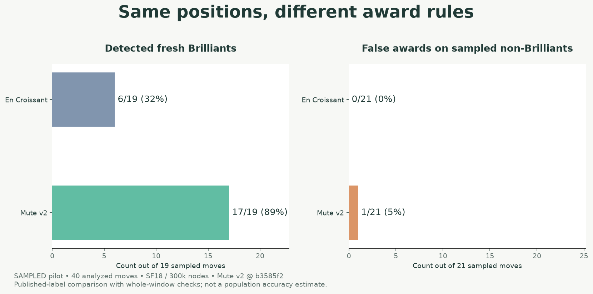
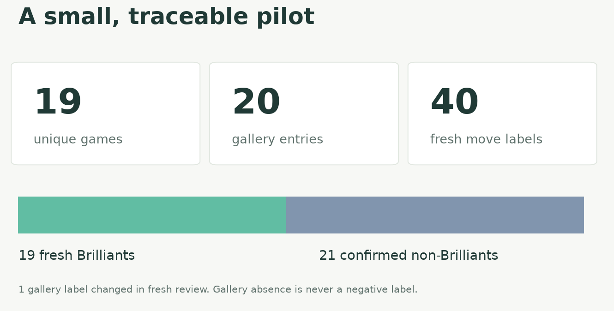
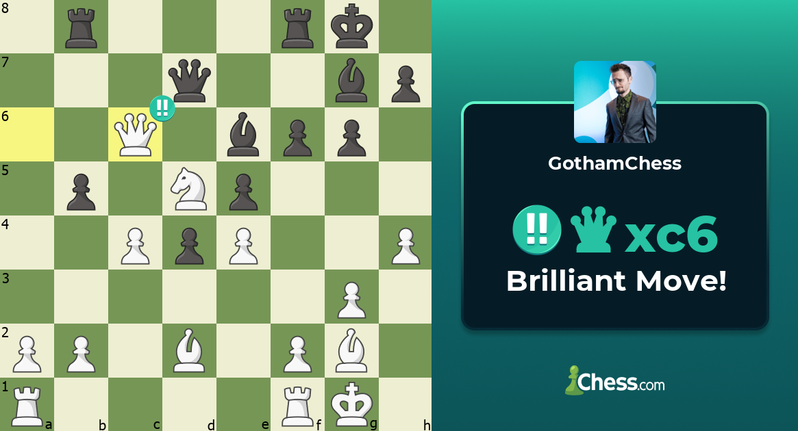
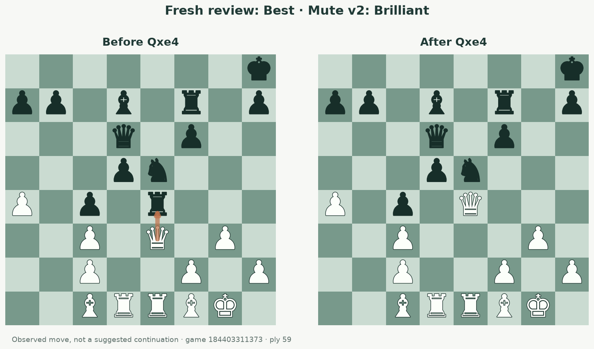
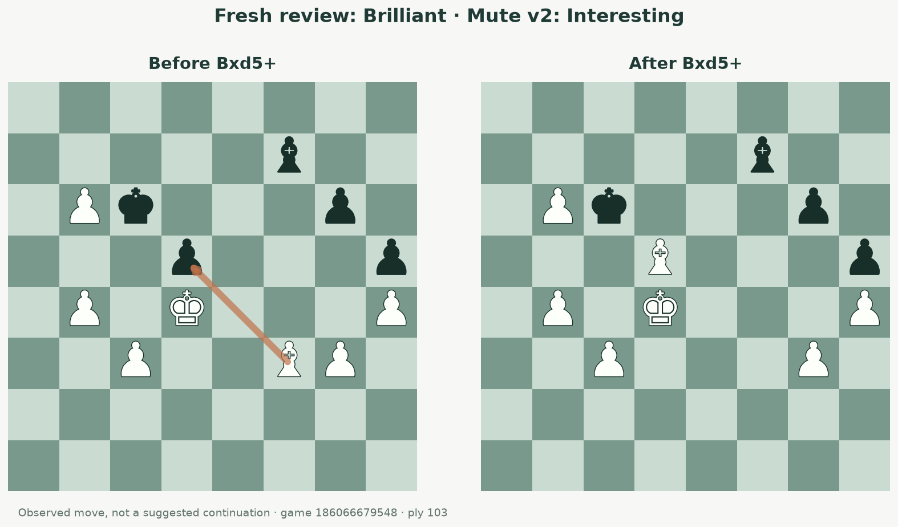
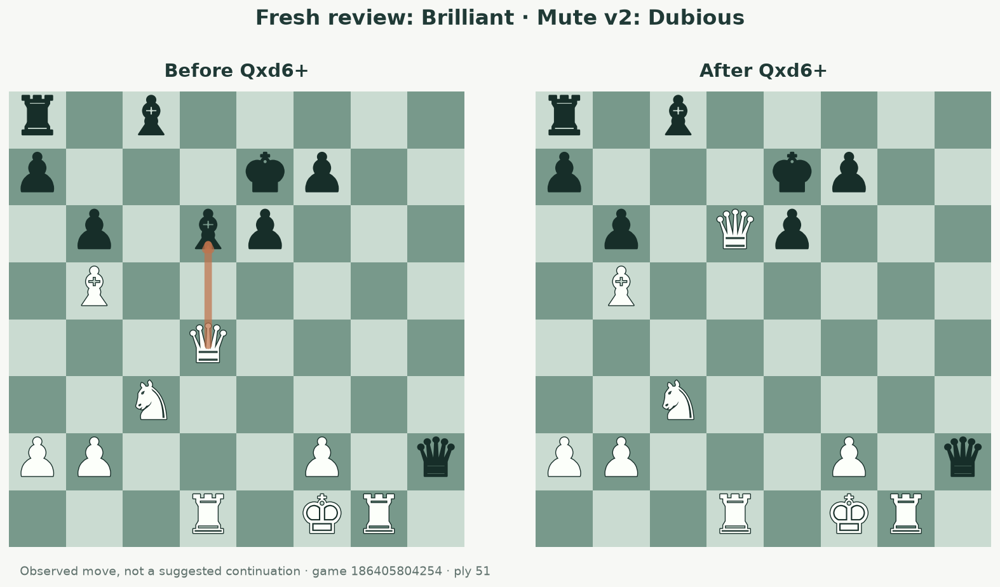

# When does a good move deserve “Brilliant”?

**A 45-minute feasibility pilot · November 3, 2026 · [Research home](../../README.md)**

The product goal is simple: make Mute Chess more fun by celebrating satisfying sacrifices. We want generous, understandable awards, while avoiding ordinary trades dressed up as brilliants.

**The pilot supports continuing the experiment.** Mute's existing v2 rules matched 17 of 19 currently displayed Chess.com brilliants in this selected sample. En Croissant matched 6. Mute also awarded one move that the current Chess.com review called Best. We found useful differences, not Chess.com's hidden formula. No classifier was tuned or deployed during this study; Mobile Maia remains unchanged.

## What we collected

We chose four gallery entries per account—one each from Queen, Rook, Bishop and Knight Sacrifice—then inspected those moves and 20 separate controls in Game Review. Sampling used the one-year galleries. Earlier displayed gallery totals were nelsi 584, hansen 541, KNVB 912, GothamChess 485 and Hikaru 997: **3,519 entries**, potentially with several moves from the same game. We did not collect that full corpus.

| Account | Gallery entries sampled | Current Brilliant | Current non-Brilliant, including controls |
| --- | ---: | ---: | ---: |
| nelsi | 4 | 4 | 4 |
| hansen | 4 | 3 | 5 |
| KNVB | 4 | 4 | 4 |
| GothamChess | 4 | 4 | 4 |
| Hikaru | 4 | 4 | 4 |
| **Total** | **20** | **19** | **21** |

There are **19 unique games, 40 unique observed moves and 60 label observations**: 20 historical gallery observations plus 40 current review observations. All 20 preselected controls were explicitly non-Brilliant. The extra negative is the gallery/review disagreement described below. A move missing from a gallery was never treated as a negative.

“Current review” means the classification displayed when we freshly opened Game Review. We did not request a deeper rerun or establish that every page initiated a new independent calculation. Review engine settings were not exposed. Historical gallery and current display evidence remain separate.

We downloaded the needed games through the documented public monthly PGN endpoint, stored each selected game once and legally replayed its complete history. All **20 gallery board placements, 60 source move indices and 40 current-review SAN identities** matched the PGNs. The database retains before/after FENs, move numbers, SAN/UCI, public game headers, ratings, available clocks, source URLs and capture timestamps. FENs are convenience views; full PGNs preserve history.

Coach explanations were captured for **33/40** current displays; **7/40** remain explicitly missing. Evaluations were captured for all 40, including one terminal result displayed as “1-0”, rather than a numeric score. We captured the selected gallery categories; additional memberships and category nonmembership were not exhaustively checked. The category can refer to an offered piece other than the moved piece: Hikaru's Qf8 appeared under Knight Sacrifice.

### One original visual example

This is Chess.com's native share-image export for [GothamChess's Qxc6, game 186305620178, ply 37](https://www.chess.com/analysis/game/live/186305620178?move=36). It is an illustrative first-party artifact, not a screenshot of every evidence record or a capture of the coach explanation. Other observations are saved as structured rendered-UI records. Chess.com imagery and branding remain theirs.

## The rules we actually compared

Both local comparisons used the same saved Stockfish 18 evidence. This isolates differences between our predicates; it does not reproduce Chess.com's engine, settings or rating adjustments.

| Rule | En Croissant reference | Current Mute v2 |
| --- | --- | --- |
| Move quality | Mapped score loss at most 5 percentage points | Same 5-point limit |
| Best-move uniqueness | Played move is first choice; best/second mapped gap exceeds 10 points | No unique-best requirement |
| Sacrifice | EC material heuristic | Legal immediate non-pawn, non-king piece offer |
| Resulting position | EC's brilliant branch and surrounding classification rules | At least −100 centipawns for the mover |
| Comfortable alternative | Uniqueness acts as a restriction | Veto if another evaluated non-sacrificing move is at least +600 centipawns |
| Confirmation in our replay | Whole-window corroboration wrapper around pinned EC annotation | Existing whole-window corroboration |

The shared mapping is **W(cp) = 100 / (1 + exp(−0.00368208 × cp))**. Scores are normalized to the mover, clamped to ±1000 centipawns, and winning/losing mates mapped to those bounds. Loss is the before/after difference in this mapping. It is a heuristic scale, **not a calibrated probability** or Chess.com's published formula. Independent finite searches can produce a negative loss; that means the after search evaluated the position more favorably, not that a move improves the theoretical position.

EC's material values are pawn 90, knight/bishop 300, rook 500 and queen 1000. Its sacrifice predicate compares material-search values before and after: `M(before) > −M(after) + 100`, outside terminal positions. Each legal root is followed by a capture-only material search. This can identify material investment, but misses some quiet tactical responses.

Mute v2 instead asks whether the opponent can legally capture a non-pawn piece and gain material through an exchange on that square. Either side may stop exchanging. The opponent's best local exchange gain must exceed **max(0, mover's immediate material gain) + 100**. This credits captures and promotions already made. Pawn-only offers and offers that arise only after a delayed continuation do not qualify. A qualifying capture may be on a different piece from the one just moved. The test does not follow recoupment on other squares.

Mute also needs at least two evaluated lines. Its +600 alternative veto only sees the evaluated roots, not every legal alternative. Awards require compatible complete current/prior decision windows, or independent matching-quality evidence at no shallower depth. A provisional label that fails corroboration is withheld. These checks reduce unstable awards; they do not prove the semantic sacrifice test correct. The unchanged EC oracle and confirmation-aware replay produced identical Brilliant counts here; one non-Brilliant provisional `!` label was separately withheld in both policies.

The frozen Mute baseline is [`b3585f2`](https://github.com/Dash1971/mute-chess/tree/b3585f2c5b818bb8dfabb7fc4e3ed37cab848c12), policy `mute-chess-brilliant-v2`, carried by `deploy/lila/patches/lila-nostr-maia.patch`. It includes changes after PR #222; the old v1 draft is not this baseline. EC is pinned to [v0.15.0, `6f2d262`](https://github.com/franciscoBSalgueiro/en-croissant/tree/6f2d2628f0fbe11cb62a7dd2f9c102bb52907d53). The inspected [Mobile Maia preview reference](https://github.com/Dash1971/maia-chess-android-preview/tree/8563954429c2fb53ce0fe0e16c73c5d8a73ccfe0) shares the EC approach; this is not a claim about its latest released binary. Exact source pins and copied predicates are in [methodology](methodology.json) and [reference notes](reference/README.md).

## Results on the selected moves

| Policy | Awarded current Brilliants | Missed current Brilliants | Awarded current non-Brilliants | Non-Brilliants receiving no !! |
| --- | ---: | ---: | ---: | ---: |
| En Croissant | **6/19 (31.6%)** | 13/19 | **0/21** | 21/21 |
| Mute v2 | **17/19 (89.5%)** | 2/19 | **1/21 (4.8%)** | 20/21 |

These are descriptive detection and false-award fractions in this chosen sample. They do not estimate production accuracy, population precision, awards per game or how fun users will find either policy. “False” here means disagreement with the observed current display, not proof of an objectively wrong chess judgment.

| Account | EC detected / current Brilliants | Mute detected / current Brilliants | Mute extra awards / current non-Brilliants |
| --- | ---: | ---: | ---: |
| nelsi | 1/4 | 3/4 | 0/4 |
| hansen | 0/3 | 3/3 | 1/5 |
| KNVB | 1/4 | 3/4 | 0/4 |
| GothamChess | 2/4 | 4/4 | 0/4 |
| Hikaru | 2/4 | 4/4 | 0/4 |

By observed gallery category, Mute detected Knight **5/5**, Rook **5/5**, Bishop **4/5** and Queen **3/4** current brilliants. EC detected **1/5, 3/5, 1/5 and 1/4**, respectively. The Queen group also contains the single changed gallery label. The other negative controls have no separately adjudicated sacrifice category; category false-award rates therefore cannot be established.

We reserved whole games before tuning: all four Hikaru games form a player holdout; full SHA-256(game ID) modulo 5 selects the remaining game holdout. All observations from a game stay together. No tuning occurred. Mute detected **11/12** development positives with **1/14** extra awards, **2/3** game-holdout positives with **0/3** extras, and **4/4** player-holdout positives with **0/4** extras. These tiny partitions demonstrate the procedure, not reliable generalization.

## Three disagreements worth understanding

### Hansen: a gallery Brilliant that now displays Best

For [30.Qxe4, game 184403311373, ply 59](https://www.chess.com/analysis/game/live/184403311373?move=58), the gallery label is Brilliant and the current review display is Best. Mute awards Brilliant; EC does not. Mute's legal-offer predicate passes while EC's net-material predicate fails. The conditional acceptance line is **30.Qxe4 dxe4 31.Rxd6**: White first takes a rook, offers the queen, then captures Black's queen on a different square. This legal line appears in the saved engine continuation; it is not a claim that Black accepted in the game. The local offer test credits the first capture but misses the later queen recoupment on d6. The same disagreement remains at five times the engine budget. We retain both Chess.com observations and use the current label in the primary comparison. We cannot establish why the historical and current labels differ.

### KNVB: an attractive sacrifice in a position already winning

For [52.Bxd5+, game 186066679548, ply 103](https://www.chess.com/analysis/game/live/186066679548?move=102), both gallery and current review say Brilliant. Mute recognizes the offer, but an evaluated safe alternative, **b7**, scores +6.75, triggering the +6 veto. At the stronger budget that alternative scores +8.46; the played continuation scores +9.04. Mute keeps Interesting, not Brilliant. This example suggests our absolute comfortable-win veto can suppress moves Chess.com still celebrates; it does not identify Chess.com's actual cutoff.

### nelsi: a winning queen offer that our mapping penalizes

For [26.Qxd6+, game 186405804254, ply 51](https://www.chess.com/analysis/game/live/186405804254?move=50), both Chess.com observations say Brilliant. Mute sees a legal offer, but the local after score is +4.16 against a safe Ne4 alternative at +6.63. The mapped loss is **9.77 points**, above our 5-point limit; the safe alternative also triggers the +6 veto. At stronger search the after score is +4.02, loss **10.53 points** and the same veto remains. Mute changes from Dubious to Mistake, still not Brilliant. Increasing search alone does not reconcile the definitions.

## What we recommend testing next

1. **Keep Mute's generous direction and keep Mobile Maia's EC policy separate.** Removing unique-best dependence finds substantially more observed brilliants here. A fun product policy can be transparent about having its own definition.
2. **Evaluate complete tactical compensation before calling an offer a sacrifice.** The known owner example `14...Ndxe5 15.Nxe5 Nxe5 16.fxe5 Rxd3` recovers material on d3 after exchanges on e5. A same-square exchange test can miss this. Quiet defensive replies matter too. Those owner cases remain separately marked regression expectations, not confirmed Chess.com negatives or independent test data.
3. **Compare alternatives by practical outcome and relative value.** Test whether a safe alternative makes the sacrifice unnecessary, rather than blindly excluding every position above +6. A drawing sacrifice, such as Hikaru's sampled Rg8+, can also be worth celebrating. Do not choose a replacement cutoff from the KNVB example alone.
4. **Study the quality mapping in already winning positions.** The nelsi case motivates testing sound winning sacrifices against the current before/after loss gate. Keep losing and unsound sacrifices in the negative sample, so generosity does not become indiscriminate praise.
5. **Measure fun as well as label agreement.** A later product experiment should record awards per game and let people inspect why a move qualified. Label similarity alone cannot measure delight.

No thresholds or implementation changes are proposed as validated by this pilot. Before changing rules, collect a larger game-disjoint sample with harder, independently categorized controls; retain a genuinely untouched test set and include a wider rating range. Our initial five accounts mainly represent strong-player behavior.

## Time, cost and a bounded next step

Preparation and collection ran **00:02:02–00:29:55 UTC: 27m 53s**, about **1.43 fresh-reviewed moves/minute**, including setup and downloads. The PGN collector initiated nine public Chess.com API requests—six monthly PGNs and three archive lists—which returned **7,049,852 body bytes**. Redirect/transport overhead was not measured. Only the 19 selected PGNs are republished.

Engine settings were Stockfish 18, **one thread, 64 MB hash, two PVs and 300,000 requested nodes per position**. We collected preceding/before/after windows in legal game order, keeping only complete exact same-depth iterations. Terminal positions are explicitly handled. There were **115 baseline snapshots** (114 searches and one terminal position needing no search) and **9 stronger snapshots** at **1,500,000 nodes**, totaling **47.7 million requested nodes** and **44.17 seconds measured engine-search time**. This excludes material probes, parsing, UI work and orchestration. Python material inputs matched the copied TypeScript implementation for all 40 moves; the independent pinned EC annotation oracle also matched. Stronger search was limited to the three mismatches selected for budget sensitivity, not a second test set.

Evidence collection dominated. Naively carrying this setup-inclusive rate to 3,519 positives gives about **41 hours**, or **82 hours** with an equally costly paired negative per entry. These are warnings about scale, not a reliable quote: one-time setup, shared games, harder controls and missing review text change the rate. Model tokens and currency cost were not exposed to the study and are not invented here.

**Recommended next decision:** authorize a second **two-hour capped collection batch**, prioritizing difficult negatives and a wider rating range, with another measured report before committing to the entire gallery. Keep its sample count subordinate to evidence quality and the time cap. The full study has not started.

## Limits and published evidence

The sample was selected for account/category coverage, not randomly. Twenty-one negatives include **16 captures and 5 quiet moves**, with overlapping tags such as recaptures, free-pawn captures, mistakes and one terminal mate. It does not fulfill balanced quotas for defended offers, unsound sacrifices, ordinary trades and cross-square recoupment. Missing coach text, unknown review settings, correlated moves within games, strong players and tiny category cells limit any inference. No beginner/rating-dependent rule can be recovered from this pilot.

Chess.com describes brilliant moves broadly as good sacrifices and says player strength affects classification; it does not publish the full formula. Its [classification explanation](https://support.chess.com/en/articles/8572705-how-are-moves-classified-what-is-a-blunder-or-brilliant-etc) and [Game Review explanation](https://support.chess.com/en/articles/8584089-how-does-game-review-work) support using observable behavior cautiously: deeper analysis/settings can change classifications. The disagreement here is consistent with that possibility, but its cause is unknown. PGNs came from the [documented Published Data API](https://www.chess.com/news/view/published-data-api), with [official PGN download guidance](https://support.chess.com/en/articles/8705305-how-do-i-get-a-pgn-of-my-game).

| Artifact | Contents |
| --- | --- |
| [Collection summary](collection-summary.json) · [Manifest](manifest.json) | Counts, timing, validation, missing fields, descriptive control taxonomy and frozen splits |
| [Methodology](methodology.json) | Source pins, score/material rules, budgets, evidence protocol and owner regressions |
| [Move table](moves.csv) · [Full observation export](observations-export.json) | Readable per-move outputs; complete public metadata, FENs and distinct observations |
| [Selected full PGNs](selected-games.pgn) · [SQLite database](corpus.sqlite3) | Nineteen original games and derived positions |
| [Public PGN provenance](public-pgn-provenance.json) | Archive URLs, retrieval times, response hashes and sanitized metadata |
| [Gallery evidence](evidence/gallery.json) · [Review batch 1](evidence/reviews-01.json) · [Review batch 2](evidence/reviews-02.json) | Rendered UI observations, not inferred labels |
| [Baseline engine evidence](analysis-baseline.json) · [Stronger evidence](analysis-stronger.json) | Complete saved engine windows |
| [Comparison outputs](comparison-rules.json) · [Stronger subset](stronger-subset.json) | Per-move decisions, gates, corroboration and exact denominators |
| [Corpus script](corpus.py) · [Engine script](analysis.py) · [Replay](replay.mts) · [Source notes](reference/README.md) | Small study-specific implementation and runtime requirements |
| [Figure script](figures.py) · [Figure sources](figures/figure-sources.json) | Regenerable charts and PGN-derived boards |

Collection and analysis scripts retain the original hard deadline rather than silently authorizing more collection. Read-only validation and replay of saved evidence are the appropriate starting points; a new run needs an explicitly agreed budget and adjusted recorded deadline. The temporary dependency paths are session fallbacks, not published dependencies. No node_modules, raw monthly response metadata, cookies or authenticated requests are included. The native share image has its own adjacent provenance record. The research was prepared with OpenAI Codex assistance; observations and limitations are available for inspection.
