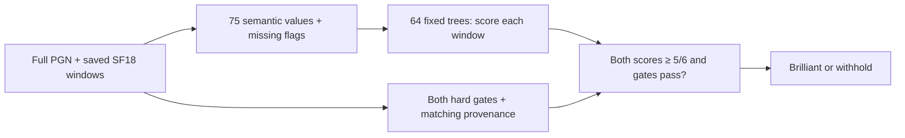

# Mute Selective: exact algorithm

**Recommendation: adopt Mute Selective, a small model we trained on chess moves labeled by Chess.com, combined with basic chess checks.** It does **not** require the separate History Rule or material-recovery guard to pass. Mute Dev handles the app merge; Mobile Maia is unchanged.

Your browser downloads the model with the analysis JavaScript and runs it locally in a background worker. It combines Stockfish evaluations with facts about the position. This is a decision-tree model evaluated by ordinary JavaScript, without ONNX, a GPU requirement, ChatGPT or a remote classification service. It does not train or change during play. The model file and training code are public. En Croissant decides the badge using developer-written rules; Mute Selective uses those basic chess checks plus patterns learned from Chess.com’s labeled examples.

The unchanged model was trained on 848 development moves. Two separate game-disjoint tests contain **400 moves from 215 games**, none used to train or tune it. The model bytes, 75 features, 64 trees and per-window 5/6 threshold are unchanged. The choice of policy follows comparison of results; this is not a new blind validation of candidate selection.

| Test evidence | Selective TP / FN / FP / TN | EC direct TP / FN / FP / TN |
| --- | ---: | ---: |
| Both independent tests, 400 moves | **112 / 88 / 3 / 197** | 53 / 147 / 3 / 197 |
| First 200 moves | 55 / 45 / 1 / 99 | 26 / 74 / 2 / 98 |
| Newest 200 moves | 57 / 43 / 2 / 98 | 27 / 73 / 1 / 99 |

Across both tests, recognition is 56%, wrong awards are 3/200 controls (1.5%), sample badge precision is 112/115 (97.4%), and overall agreement is 77.25%. The 97.4% badge fraction is not overall agreement or a calibrated deployment probability. These are balanced, selected samples from five established accounts, with games contributing multiple moves. They do not establish ordinary-game badge frequency, beginner behavior or device/browser performance.

The History Rule finds more Brilliants but gives too many undeserved badges to justify choosing it: newest 200 results are 78TP/22FN/13FP/87TN, versus the selected model’s 57/43/2/98. We retain that comparison and its source openly; it is not a second recommendation.

[Joined 400-test predictions](data/selective-independent-tests.json), [compact move evidence](data/selective-independent-moves.csv), [new replay freeze/results](data/selective-replay/RESULTS.json), and [exact source hashes](data/selective-replay/RUN-FREEZE.json) document the result. No thresholds or weights were changed. Future candidates should be fixed before their new-game tests.

## Exact selected decision

```text
eligible_window = at least two before roots
                  AND legal raw piece offer
                  AND mapped move-quality loss <= 5
                  AND mover-relative after score >= -100

award = eligible_current AND eligible_previous
        AND matching required engine provenance
        AND mean_raw_leaf_fraction_current >= 5/6
        AND mean_raw_leaf_fraction_previous >= 5/6
```

The score normalization, offer test, features, raw leaf fractions, missingness and finite helper limits are specified below. EC material, phase, winning alternatives and history are features, not additional hard History Rule gates.

## Shared inputs, scoring and legal offers

Inputs are a full legal standard-chess PGN, a target one-based ply, and ordered engine snapshots for the previous own-after position, before-position and after-position. Near the start, duplicate initial positions are removed. Snapshots contain exact FEN, explicit engine/configuration provenance, current and actual preceding completed iterations, terminal state, score and legal UCI principal variations.

The validated extraction domain is the pinned **SF18**, **300,000 requested nodes**, **Threads 1**, **Hash 64 MB**, **MultiPV 2 where two legal roots exist**, full PGN history and the recorded complete-iteration convention. The extractor verifies target/PV legality and position identity. A matching provenance string alone cannot prove that a caller really used the declared engine/options.

Native SF19, varying browser depths/budgets, other engines and changed MultiPV are outside this validation. Castling, en passant and promotion have legal feature/abstention fixtures, but none occurs among the 848 development cases. The special-move fixtures establish legal handling, not empirical accuracy for those move types. Special-move fixture handling does not establish model calibration. Other variants are unsupported.

### Shared quality and offer gates

Scores are normalized to the mover. Let

```text
C(score, mover) = clamp(mover-relative centipawns, -1000, +1000)
                 or 1000 × sign(mover-relative mate distance)
W(c) = 100 / (1 + exp(-0.00368208 × c))
loss_w = W(best before-position score_w) - W(best after-position score_w)
```

Mate 0 maps to 0. The after-position search is the position after the played move. The quality gate uses that child-position score, not an invented before-search score for an unsearched played root. W is a scoring heuristic, not a calibrated human winning probability.

For **each** current/prior completed analysis window:

```text
eligible_w = before-root-count_w >= 2
             AND raw_piece_offer(before, after)
             AND loss_w <= 5
             AND C(after_w, mover) >= -100
```

The raw offer test is unchanged: the after-position is nonterminal, and some opponent legal capture/exchange on a knight, bishop, rook or queen has static exchange gain **strictly greater** than

```text
max(0, physical mover material_after - physical mover material_before) + 100.
```

Values are pawn 90, knight 300, bishop 300, rook 500, queen 1000, king 0. Capture/promotion gains are credited. The piece offered need not be the piece moved. The one-square exchange evaluator considers legal captures and permits stopping; it is a local material heuristic, including its stop convention in check, not a proof over all legal continuations. The frozen raw-offer recursion has no explicit node cap.


For the selected system, these hard eligibility requirements are followed by the fixed model decision below. History/recovery restrictions are not extra required gates.


## Fixed features, model and proof limits

### Semantic features and explicit missingness

The features describe engine quality/root availability and depth; before/after/prior scores; physical and EC material; immediate gains and phase; moved/offered piece roles; checks/captures/special moves; legal acceptance cost; bounded material recovery; prior raw vulnerability; forcing/stalemate/avoidability context; and unknown/absent evidence.

There are no account IDs, ratings, dates, clocks, gallery categories, coach text, observed labels, game IDs, raw board-square encodings or move-string identities among the predictors. PGN headers are metadata, not inputs to prediction. A move absent from the saved roots has null rank/gap; it is not assigned a favorable value.

The 75 ordered values are followed by 75 indicators `feature__missing`. None, False and 0 are distinct. Missing numeric values route left in a tree; explicit missing indicators remain available. The exact field definitions and ordering are linked below. In particular, `mating_acceptance` is the existing additional corroboration flag evaluated when EC material sacrifice is absent; its inapplicable False value does not prove that no mating acceptance exists.

EC material, phase, winning alternatives and history flags are **features**, not additional universal vetoes for the forest. The forest is not silently combined with the separate history rule.

### Score the frozen 64-tree model

The prospective model is [the full-data forest](reference/v5/learning-v5/forest-diagnostic/forest-full.json), SHA-256:

```text
44704ac06378d3f671a4eed959e21959f759c0437c71af1f9119d1081293c0b7
```

For each window, route its 150 values through all 64 stored trees. Numeric values use the left branch at `value <= threshold`; None also routes left. Each leaf stores its **unweighted positive bootstrap-window fraction**, not a class-cost-weighted or calibrated probability. Average those 64 leaf fractions:

```text
p_w = (1/64) × sum(raw_positive_fraction(tree_leaf_w))
award = eligible_current AND eligible_prior
        AND case_confidence_sufficient
        AND min(p_current, p_prior) >= 5/6
```

The threshold is **5/6**, approximately 0.8333, in both windows. It is not the earlier diagnostic’s 0.98 operating point, and it is not a guarantee of 83.3% or 99% real-world badge precision. Do not average the two window scores together and test only their mean.

Case confidence requires the recorded matching before/after analysis provenance; both actual completed-window predictions must pass. Missing required engine iterations cannot establish eligibility. A terminal after-position uses the reference contract’s exact terminal evidence in the prior-window comparison; other final scores are never copied to manufacture corroboration.



### Frozen training procedure

The model has 64 trees, maximum depth 6, minimum 8 distinct original moves per leaf, 12 randomly selected features per split and seed 20261103. Whole game/identical-before-position union groups are bootstrapped with replacement; current/prior windows are not resampled independently. A training window’s Gini weight is `(5 if non-Brilliant else 1) / eligible-window-count-for-that-move`, multiplied by its sampled group multiplicity. Minimum leaf size counts unique original moves, not bootstrap copies. Raw leaf fractions ignore class-cost weights.

The complete [training protocol](reference/v5/learning-v5/forest-diagnostic/PROTOCOL.json), [fit source](reference/v5/learning-v5/forest-diagnostic/fit.py), model artifact and recorded hashes define the fixed result. The full-data model is used on new games; the five fold-specific models are not substituted as prospective predictors.

### Proof and search limits

| Component | Frozen limit and uncertainty handling |
| --- | --- |
| Raw one-square offer test | No explicit node/wall cap; finite legal same-square capture recursion with stopping. |
| EC material heuristic | No explicit node/wall cap in the copied helper; all legal initial roots then capture-only continuation, with its check/quiet and terminal-sentinel limitations. This is not physical material. |
| Added literal mate / checked-continuation helpers |512 counted positions per helper invocation. Exhaustion cannot establish the corresponding witness. |
| Forest prior-offer attribution |512 shared counted exchange nodes; retain explicit attribution unknownness. |
| Forest all-root offer avoidability |512 counted nodes; budget exhaustion is None, never a completed unavoidable-offer proof. |
| Forest direct-stalemate probe |512 counted nodes; incomplete enumeration stays unknown. |
| Physical material-recovery feature | Three plies after a qualifying acceptance; captures/promotions, all legal evasions in check, stopping only outside check. Shared 10,000 nodes and 250 ms per target. A checked horizon and mate leaves are flagged; no mate-score sentinel becomes physical material. |
| Physical acceptance’s same-square SEE | Separate 100,000-call and 1-second limits per acceptance. |

Physical timeout clears the relevant debt values to None while preserving the source-defined partial acceptance features and diagnostics. The frozen model can still route optional proof-feature unknowns; they do not imply a new blanket abstention rule. There were no physical-unknown training cases, and no physical timeout occurred in the fresh test, so timeout behavior remains an unvalidated edge. Do not hide it, fill it from an old-case lookup or increase a cap after seeing test labels. Wall-clock caps can produce load-dependent unknownness. The 250 ms physical-search check occurs at search visits; the separate acceptance SEE has its own 1-second limit, so 250 ms is not an end-to-end latency guarantee.

The [standalone extractor contract](reference/v5/astra/v5/fresh-extractor/CONTRACT.md), [code](reference/v5/astra/v5/fresh-extractor/extractor.py), [feature kernel](reference/v5/astra/v5/fresh-extractor/feature_kernel.py) and [freeze manifest](reference/v5/astra/v5/fresh-extractor/FREEZE.json) are authoritative. Independent 848-case checks reproduced all 75 values/missingness, eligibility, confidence and full-model decisions with no differences. Those are implementation parity checks, not validation accuracy.

### Observed optional unknowns in the first 200-move test

In the first test, all 200 cases had sufficient required engine confidence; all 581 core snapshots had actual preceding completed iterations. No physical-feature timeout or S proof unknown occurred. Four avoidability proofs were unknown in both analysis windows and retained the frozen missing-value routing. The 2,724 total None fields across 400 windows also include ordinary inapplicability: alternate cp/mate fields, a played move absent from the saved top two roots, no safe alternative, or no qualifying offer for physical debt. They must not all be counted as failed proofs. Full per-field counts, diagnostics and affected keys are saved with the predictions.


### Exact ordered 75-field schema

```text
after_cp, after_depth, after_mapped_score, after_mate
after_minus_prior_cp, already_vulnerable_same_square_count, attribution_unknown, avoidability
avoidability_unknown, before_depth, before_roots, best_cp
best_mapped_score, best_mate, best_minus_prior_cp, best_second_gap_pp
capture_promotion_credit, checked_continuation, converted_material_or_endgame, direct_stalemate_acceptance
ec_material_after, ec_material_before, ec_material_margin, ec_sacrifice
immediate_material_gain, mapped_loss_pp, mating_acceptance, move_capture
move_castling, move_check, move_en_passant, move_in_check
move_promotion, moved_role_b, moved_role_k, moved_role_n
moved_role_p, moved_role_q, moved_role_r, offer_exchange_gain_max
offer_exchange_gain_min, offered_piece_count, offered_piece_moved, offered_role_b
offered_role_k, offered_role_n, offered_role_p, offered_role_q
offered_role_r, phase, physical_checked_horizon, physical_debt3_max
physical_debt3_min, physical_mate_leaf, physical_unknown, played_root_cp
played_root_mapped_score, played_root_mate, played_root_missing, prior_cp
prior_depth, prior_history_missing, prior_mapped_score, prior_mate
prior_offer_gain_original_square_max, prior_offer_gain_same_square_max, raw_material_after, raw_material_before
raw_offer, safe_alternative_best_cp, same_root_loss_pp, same_root_rank
stalemate_probe_unknown, window_complete, winning_safe_alternatives
```


## Native selective-model prototype and recorded-input parity

The selective model has a bounded [TypeScript reference port](reference/v5/README.md#native-typescript-prototype) reproduces all 75 features, missingness, scores and integrated decisions on the **1,048 recorded SF18 cases**, including the 200-move test, with no award or EC-result differences (maximum floating difference 2.84e−14). This is implementation parity, not another accuracy test or a claim of native SF19 validation. The native prototype adds an explicit physical-probe-timeout withholding guard; no such timeout occurred on these cases, so this additional abstention did not change their outputs. Frozen research decisions and the native guard remain distinct contracts.

Native module SHA-256: `10ac40a04d29492e85d09ddfbd0ac5c8ab32f64a8dce28cb6d78cd1cecbfb499`; classifier SHA-256: `be222880d7158a6ae3604bd482cb1e218d69c59ee815ea0a0c6ad34e4f1b18c9`. The [source/path audit](reference/v5/native/PATH-PROVENANCE.json) and [parity trace](reference/v5/native/parity.json) accompany the readable reference. No merge or deployment is claimed. **The separate fixed SF19 assessment below is limited; variable-budget and browser validation remain limited.**


## Comparison only: History Rule and material recovery

The separate hand-written History Rule combines soundness/offer gates, material or mating corroboration, a phase-aware safe-winning-alternative check and bounded earlier-offer checks. Its added recovery guard examines an unmoved, already exposed piece, requires both after-window best roots to accept qualifying offers, and checks every legal defense after a quiet reply for stabilized material recovery. It was designed using the known examples. Its newer 200 test produced 78 correct awards and 13 wrong awards; the guard changed no decisions there.

That approach is not required by the selected model. Keep [the exact History sources](reference/native-history-v7/SOURCE-MAPPING.json), [recovery source and fixed caps](reference/history-recovery/candidate.py), [material proof](reference/history-recovery/probe.py), [recovery audit](data/history-recovery-audit.json), [new-game comparison](data/prospective-history/PRIMARY-AUDIT.json) and [Methods](METHODS.md) as separate evidence.

## Illustrated outcomes

The selected model misses Hikaru’s Bg2, a recorded Brilliant. It withholds both ordinary hxg6/hxg5 examples; their exact frozen test scores are preserved in the first-test predictions. Their animations explain chess possibilities, not a tree-level causal explanation. The model also misses the outside Brilliant Nxd5 reference. These limitations remain visible rather than being portrayed as successes.

## Further work

Recognize more genuine Brilliants while keeping wrong awards low. More labeled examples can help, especially missed Brilliants and difficult ordinary tactics. The 400 current test moves can be reassigned to training for a future model; they then cease to be an independent test of that model. Keep this model and its historical results unchanged. Reserve different complete games, exclude duplicate positions across the training/test boundary, and freeze the new model before evaluating it on those new games. Report recognized Brilliants and wrong awards together. Do not tune the threshold against the same test labels or combine a favorable result from one engine/budget with another. Current validation uses saved SF18/300k windows; the separate native whole-game assessment tested the History Rule, not this selected model, and does not qualify selective-model SF19 or variable-budget/browser behavior.

## Native replay on the new 200 saved inputs

The unchanged native selective module and integrated classifier match the fixed scientific reference on the 200 new SF18 inputs: zero feature/missingness, score, award, integrated-classifier or EC-result differences; maximum floating difference 2.84e−14. There were no physical-probe unknowns. One optional avoidability proof remains unknown in both windows and retains the frozen missing routing. [Summary](data/selective-replay/native-parity-summary.json) and [trace](data/selective-replay/native-parity-trace.json) pin module 10ac40a…, classifier be222880… and exact model 44704ac….

This is implementation parity on saved SF18 inputs, not native SF19 accuracy, variable-budget/browser validation or a new independent test. The older 10-game History execution assessment remains separate and does not measure Mute Selective’s native accuracy. Mute Dev handles the app merge.
