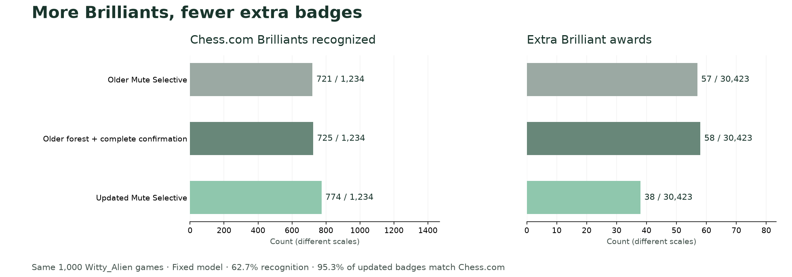

# More Brilliants, with fewer wrong badges

Brilliant moves make chess more fun. Our goal is to bring more of that feeling to an open chess platform, while keeping the badge meaningful.

We recommend the updated **Mute Selective** model: a small model trained on 6,293 labeled chess examples, used alongside chess rules that check move quality and real piece offers. It runs locally in the browser as ordinary JavaScript, without a neural network or remote AI service. It stays fixed during play. The model and complete research are published here; release in Mute Chess remains a separate decision for Mute Dev.

## What happened on new games?

We tested the fixed model on **1,000 Witty_Alien games**, an account excluded from its development data. On 1,234 Chess.com Brilliants and 30,423 other moves, it produced:

| Version | Chess.com Brilliants recognized | Extra Brilliant awards |
|---|---:|---:|
| Older Mute Selective | 721 / 1,234 | 57 / 30,423 |
| Older forest + complete confirmation | 725 / 1,234 | 58 / 30,423 |
| **Updated Mute Selective** | **774 / 1,234** | **38 / 30,423** |

The middle row preserves the preceding position’s evidence when rechecking a possible award. The updated model uses that same confirmation process and the same six-search limit.

Compared with the older forest using complete confirmation, the update recognized **49 more genuine Brilliants and gave 20 fewer extra awards** overall.

The updated model recognized **62.7%** of Chess.com’s Brilliants. Of its 812 Brilliant awards, **774 matched Chess.com: 95.3%**. That still leaves **38 extra awards—4.7% of its badges**. The goal of fewer than 1% wrong badges has not been reached.

These are net improvements, not improvements on every move. Against the older forest with complete confirmation, it found 95 previously missed Brilliants but missed 46 previously recognized ones. It removed 27 extra awards and introduced seven others.

## How does it decide?

1. Check that the move is good enough according to the engine.
2. Check for a genuine, legally capturable piece offer; an ordinary trade alone is not enough.
3. Describe the position using chess features, including material, move quality, mating threats, and possible recovery of offered material.
4. Ask the fixed forest of decision trees whether the move resembles the labeled Brilliant examples.
5. Require both completed engine checks to pass the same standard. Unfinished required checks do not earn a Brilliant badge.

More generous versions found more Brilliants in development, but gave too many extra badges to justify choosing them. We chose the more selective setting. It still misses worthwhile moves, including some attractive quiet sacrifices; matching Chess.com perfectly is not claimed.

## What did we study?

Development covered **3,473 benchmark games from six accounts**, plus two separate owner examples. The new test covered another account, Witty_Alien. We publish the full games, labels, models, recipes, engine evidence, raw decisions, and failed attempts—not just successful examples.

The downloadable collection contains **7,019 games and 8,298 Brilliant annotations from seven accounts**. It is larger than the test: the complete Witty gallery contains 3,546 games, of which the fixed test used 1,000. Verification strength varies by label and is recorded in the data.

[Download the seven-account PGN](data/seven-accounts-last-12-months-chesscom-brilliants.pgn) · [Methods and limitations](METHODS.md) · [Exact algorithm and reproduction](README.md)

## Recommendation

Adopt the updated Mute Selective model with complete confirmation, and keep improving the remaining wrong awards. The result supports this choice on the games studied, not a promise about every player or every engine setting. These games came from Brilliant galleries; their error rate is not a site-wide estimate. The model stayed fixed throughout testing.
