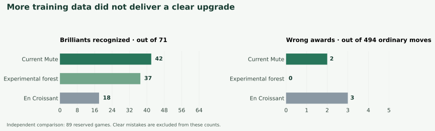

# Can more examples improve Mute’s brilliant-move model?

We want an open implementation that celebrates the same kinds of moves as Chess.com, while avoiding brilliant awards for ordinary material-winning tactics. We studied labeled Chess.com games and compared Mute’s small, locally running model with an experimental model trained on more examples and with En Croissant’s chess rules.

**Conclusion: we have not established a better replacement for the current Mute model.** The experimental model made fewer wrong awards, but also missed more genuine Brilliants. Larger forests and a different learning method did not establish the improvement we wanted. These are research results; the live model is unchanged.

## What we found

We kept 89 complete games out of training and compared the frozen models on exactly the same positions.

| Method | Chess.com Brilliants recognized | Ordinary moves wrongly awarded |
| --- | ---: | ---: |
| Current Mute | **42 of 71** | 2 of 494 |
| Experimental forest trained on more examples | 37 of 71 | **0 of 494** |
| En Croissant | 18 of 71 | 3 of 494 |

All three rejected the 89 additional examples labeled as clear mistakes. Those easy examples are reported separately rather than used to inflate an accuracy percentage. Zero wrong awards in this sample does not mean a model will never make one.

Mute recognized more than twice as many Brilliants as En Croissant in this comparison. The expanded-data model was more selective than current Mute, but the loss of five genuine awards means it was not a clear overall upgrade. This result concerns these sampled positions, not every game, rating level, or open-source classifier.

## How we studied it

We saved **422 complete games from five accounts**: GothamChess, Hikaru, KNVB, hansen, and nelsi. Their reviewed games supplied **390 verified Brilliant moves**, **2,351 challenging ordinary moves**, **7,669 clear errors**, and **46 other explicitly labeled non-Brilliants**. A missing Brilliant annotation was never treated as evidence that a move was ordinary.

Each Brilliant was checked against its visible Chess.com label, exact move, and complete board position. Full PGNs preserve the preceding play, including sacrifices that recover material on a different square. Games were assigned to training or reserved testing before their fresh labels were collected. Positions overlapping known examples or training positions were excluded from the independent comparison.

The combined training set contained **3,724 distinct moves, including 917 Brilliants, from 987 games**. Whole games and repeated positions stayed together when evaluating training choices. The 89 reserved games were separate from training.

En Croissant uses chess rules. Mute trains a small decision-tree model on labeled examples, then runs that model locally in the browser. It does not send each position to a classification service. The model considers engine evaluation, offered material, compensation, alternatives, and the preceding position. It must also pass chess-quality checks and agree across two engine analysis windows before awarding a Brilliant.

We tested changes to the penalty for wrong awards, decision thresholds, tree complexity, and sequential learning that emphasizes repeatedly misclassified examples. We also added information about which offered piece the opponent takes and whether its material value comes back over the following moves. Training choices used training data only. Some methods recognized more Brilliants but increased false awards; capture-sequence information gave small, inconsistent development gains. None established the combination we want: substantially more genuine awards while keeping false awards low.

## What should improve next?

The strongest next question is what happens **if the opponent takes the offered piece**, including captures absent from the saved engine lines. An engine's preferred defense sometimes declines a genuine sacrifice, leaving its consequences unexamined. That missing evidence affects roughly a third of the training Brilliants that pass the chess-quality checks. Studying those replies may help distinguish a real investment from an ordinary recovery tactic; it is a hypothesis to test, not a proven fix.

Further work should compare matched genuine sacrifices and ordinary recovery tactics, then validate any improvement on new games. More labels can help, but this study does not support the claim that adding examples alone will solve the problem.

Keep current Mute as the reference implementation. Do not promote these experimental artifacts on the strength of training results or repeated evaluation of the same games.

## Data and reproducibility

- [Corpus and original PGNs](data/CORPUS-MANIFEST.json): hashes and provenance for the compressed games, labels, and factual evidence.
- [Independent comparison](RESULTS.json): every scored move and separate results for Brilliants, hard ordinary moves, and easy errors.
- [Training lineage](TRAINING-LINEAGE-CHECK.json): verification that all original training examples are represented.
- [Training data](data/training.json): deduplicated examples, features, aliases, and game groups.
- [Experimental model freeze](model/MODEL-FREEZE.json): frozen model and training protocol hashes.
- [Training-only optimization](optimization/RESULTS.json), [capacity comparison](capacity-optimization-warning-allowed/RESULTS.json), and [sequential-learning comparison](boosting-optimization/RESULTS.json).
- [Capture-sequence feature comparison](pv-trajectory-experiment/RESULTS.json), [frozen feature definitions](code/pv-trajectory-experiment/SCHEMA-FREEZE.json), and [training PGNs and saved lines](pv-trajectory-experiment/source-pack/MANIFEST.json).
- [Source and engine-evidence manifest](code/SOURCE-MANIFEST.json): exact code snapshots, source pins, and compressed saved engine outputs. The snapshots retain the research machine's original paths; they are an audit record, not an installed software package.

The independent table uses the model frozen before reserved-game scoring. Additional training experiments and repeated comparisons are development results, not new independent tests or evidence for promotion.

The sample emphasizes strong players and reviewed games containing relevant tactics. It cannot establish beginner behavior or the frequency of brilliant moves in ordinary play. Chess.com does not publish its full classification formula; its labels can also change when analysis changes. Collection was limited by local memory pressure. One incomplete game was preserved but excluded.
